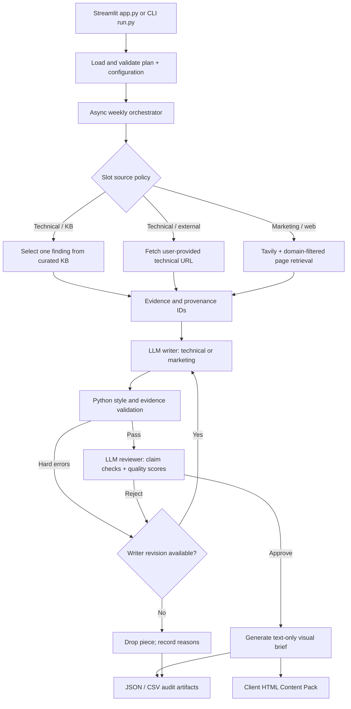

<div align="center">

# SanadSquad — System Architecture

**Research → Write → Review → Deliver**

A code-grounded overview of the current multi-agent content pipeline, its data flow, source controls, execution model, and outputs.

[README](README.md) · [Quick Start](README.md#-quick-start) · [Recorded Sample](output/sample-run/run_summary.json)

</div>

---

## ✦ 1. Architecture at a Glance

The default weekly plan is **3 technical threads + 3 marketing posts**. Each slot moves through a LangGraph workflow, while independent slots are scheduled concurrently by Python `asyncio` with a configurable limit.



**The diagram describes implemented routing.** The visual stage writes a description; it does **not** call an image model, produce image files, or display generated pictures. Nothing is published to X automatically.

## ✦ 2. Code Ownership and Boundaries

| Component | Current implementation | Purpose |
|:---|:---|:---|
| UI | [`app.py`](app.py) | Edit six slots, run live workflows, inspect results, retry failures, download HTML and audit ZIP |
| CLI | [`run.py`](run.py) | Demo/live modes, weekly or one-piece execution, output paths and retry reuse |
| Orchestration | [`sanad/agents.py`](sanad/agents.py) | `Pipeline` state graph, agent nodes, conditional revisions and `run_week()` |
| Knowledge and web research | [`sanad/research.py`](sanad/research.py) | Local KB matching, Tavily search, domain validation, page fetching, offline research fixtures |
| Evidence helpers | [`sanad/skills.py`](sanad/skills.py) | Evidence IDs, exact quotes, canonical citations and excerpt selection |
| Review and validation | [`sanad/quality.py`](sanad/quality.py) | Deterministic style/evidence checks, judge verdict checks and editorial constraints |
| LLM adapter | [`sanad/providers.py`](sanad/providers.py) | OpenAI-compatible calls, structured outputs, token pacing, timeouts/retries and usage reporting |
| Contracts and config | [`sanad/config.py`](sanad/config.py) | Pydantic `Plan`, `Slot`, `Draft`, `Judgment`, source-routing validation and data loading |
| Client handoff | [`sanad/delivery.py`](sanad/delivery.py) | Standalone browser-readable HTML with copy controls and written visual concepts |
| Tests | [`tests/`](tests/) | Offline unit tests and regression scenarios |

There are multiple **logical agent roles**, but they do not require different LLM models. Research selection, writing and judging can use the same configured Groq-hosted model with different instructions, schemas and evidence. The text-only visual stage is deterministic and consumes no model tokens.

## ✦ 3. Evidence and Research Routing

Source policy is **enforced in code** using Pydantic plan validation and the research branch—not just prompt instructions.

| Content type | Permitted input | What happens |
|:---|:---|:---|
| Technical thread: `source_mode=kb` | Curated findings in `data/kb.json` | Find candidate findings; an LLM chooses among candidates; use **one finding** per thread and preserve its evidence IDs |
| Technical thread: `source_mode=external` | A user-provided technical page URL | Fetch the page in live mode and use its retrieved text as evidence; if the fetch fails, fail the slot |
| Marketing post: `source_mode=web` | Tavily results restricted by `data/sources.json` | Search and fetch allowed pages, select sources and ground the post in retrieved evidence |

Marketing **does not fall back to the local KB** if web research fails. An optional, explicitly selected vulnerability KB citation can supplement an externally sourced marketing post, but cannot replace its web evidence. Approved marketing copy also follows `data/marketing-rules.md` and the brand voice.

**Technical note:** this code implements curated-knowledge retrieval and grounded web evidence selection. It does **not** currently contain an embedding-based vector database or a dedicated semantic RAG index. Do not describe it as deployed vector RAG.

## ✦ 4. Per-Slot LangGraph Execution

The `Pipeline` in `sanad/agents.py` creates these graph nodes:

1. **Research** — Resolve a KB finding or fetched source; construct evidence IDs, excerpts and provenance.
2. **Write** — Select the technical or marketing writing instructions; generate a structured `Draft`; clean formatting and normalize evidence references.
3. **Review** — Apply deterministic validation **before** requesting the LLM judge. When eligible, request claim-level exact evidence quotes and scores, and validate the verdict with Python.
4. **Visual** — Select a template layout/symbol and produce a **written image description** (`image_generated: false`).

The graph can route a rejected piece back from `review` to `write`. The current [`data/style.json`](data/style.json) specifies `max_revisions: 2`, so the normal upper bound is **one initial draft + two writer revisions**. A piece that still fails is marked `dropped`; a research, model or execution error can mark it `failed`. Other slots continue.

Additional reviewer-only quote-format repair and evidence-preserving draft pruning may be attempted in review; neither is an automatic override of factual or style rejections.

### Review gates

| Gate | Implementation |
|:---|:---|
| Structural validity | Pydantic contracts in `sanad/config.py` |
| Tweet lengths, counts, prohibited wording, required source IDs | `style_checks()` in `sanad/quality.py` |
| Claim support and contextual editorial quality | LLM reviewer plus exact-quote/evidence verification in `evaluate()` |
| Minimum approval | **16/20 total** and **at least 3/5** in accuracy, usefulness, clarity and brand fit |
| Publication decision | Only `shipped` pieces enter `final_content.json`, HTML and `posts.csv` |

These checks reduce bad output but cannot establish that every accepted security claim is true. **Human fact-checking remains necessary.**

## ✦ 5. Parallelism, Provider Limits and Recovery

- **Across slots:** `run_week()` uses `asyncio.gather()` plus an `asyncio.Semaphore`; the normal/default concurrency is **2** (allowed range **1–8**).
- **Within a slot:** research → write → review → visual executes in sequence, apart from deliberate revision loops.
- **Model access:** the live client uses an OpenAI-compatible endpoint; for the provided setup that endpoint is Groq, configured in the local `.env` file.
- **Rate-limit handling:** provider retries and a process-local token gate pace requests. This does not increase Groq account quotas or guarantee zero HTTP 429 errors.
- **Retry failed pieces:** from the Streamlit interface or CLI `--reuse`, a new run may reuse previously shipped pieces if slot and configuration match; the failed/unapproved work can be retried without regenerating approved content.
- **Demo mode:** CLI fixtures are for offline illustration and testing. The Streamlit UI triggers **live runs**; demo outputs are not actual live research.

The program is designed for a trusted local workflow. It has no durable distributed job queue or automatic posting scheduler.

## ✦ 6. Data Contracts, Configuration and Controls

| Change | File |
|:---|:---|
| Weekly topics and source modes | [`data/plan.json`](data/plan.json) |
| Vulnerabilities and root causes | `data/kb.json`, `data/root-causes.json` |
| Brand voice and specialist prompts | `data/brand-voice.md`, `data/prompts.md` |
| Marketing services, permitted sources and restrictions | `data/marketing-rules.md`, `data/sources.json` |
| Length limits, scores, revision policy and post types | `data/style.json`, `data/post-types.json` |
| Text-only visual-description style | `data/visual-style.json` |
| HTML content-pack styling and controls | `sanad/delivery.py` |
| Provider/API credentials | `.env` locally (use `.env.example` as a template; **never commit secrets**) |

The `Slot` and `Plan` schemas reject invalid routing—for example, a marketing post cannot switch itself to the technical KB path. Structured drafts and review results are checked against Pydantic contracts.

## ✦ 7. Outputs and Delivery Flow

`run_week()` writes a **new output directory** for each run. The important files are:

| File | Contents |
|:---|:---|
| `content_delivery.html` | **Primary client deliverable**: only approved threads/posts, with copy controls and text-only visual descriptions |
| `final_content.json` | Approved content with individual posts, evidence references and description text |
| `posts.csv` | Compatibility export: `Post Text` and `Image` (the latter is **text**, not an image path) |
| `research_log.json`, `resolved_plan.json` | Source choices, provenance, research attempts and resolved slot configuration |
| `drafts.json`, `review_report.json` | Draft attempts, decisions, scores, feedback and evidence checks |
| `run_summary.json`, `events.json`, `pieces.json` | Counts, statuses, usage, timing and detailed pipeline state |
| `visuals/<slot>.json` | Structured visual-description specifications, not generated media |

The UI downloads `content_delivery.html` with the filename **`SanadSquad_Content_Pack.html`**. Its **full report ZIP** contains run-detail JSON/CSV artifacts; the HTML file is downloaded separately.

A successful recorded live output is retained under [`output/sample-run/`](output/sample-run/). The [`run_summary.json`](output/sample-run/run_summary.json) shows **6/6 shipped, zero dropped/failed** for that archived execution on **October 22, 2026**. This is evidence of a completed recorded run, **not** an assurance about future runs or factual validity.

## ✦ 8. Local Commands and Verification

```bash
# Install project dependencies (Python 3.11+)
python -m pip install -r requirements.txt

# Start the Streamlit UI (live generation)
python -m streamlit run app.py

# Exercise the deterministic offline demo, not a live model run
python run.py --mode demo

# Live six-slot execution (requires Groq-compatible and Tavily keys)
python run.py --mode live --concurrency 2

# Automated checks
python -m pytest -q
```

**Verification scope:** the saved live run demonstrates one prior execution. The current environment may not have all runtime packages or live API credentials available, so rebuilding the archive and updating documentation does not itself prove a fresh end-to-end live execution.

## ✦ 9. Known Limitations

- No full guarantee of factual correctness from a source ID, exact-quote check or LLM approval score.
- Marketing research requires reachable allowlisted sources and a valid Tavily API key.
- No vector database, embedding search, or autonomous publication platform is implemented here.
- No actual image generation; all visual outputs are written descriptions only.
- Long-running jobs are process-local; server restarts may interrupt an active execution.
- Provider cost estimates can be unknown when usage or rates are unavailable.

---

<div align="center">

**SanadSquad · Research with sources. Review with evidence. Deliver with a trail.**

[Back to README](README.md)

</div>
