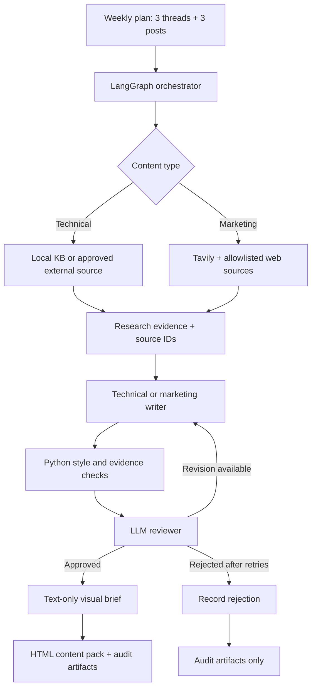

<div align="center">

<br>


<br>


### One content plan. Specialised agents. Evidence-first delivery.

**A multi-agent content system that researches, drafts, reviews, and packages technical security threads and marketing posts for X (Twitter).**

Research with evidence. Write in the brand's voice. Review before delivery. **Nothing is posted automatically.**

[Quick Start](#-quick-start) · [Workflow](#-how-it-works) · [Architecture](ARCHITECTURE.md) · [Sample Run](#-recorded-live-run) · [Limitations](#-limitations)

</div>

---

## ✦ What Is SanadSquad?

Producing a useful week of security content requires reliable sources, consistent writing, and editorial checks. **SanadSquad Content Studio** brings those steps into a repeatable, reviewable workflow instead of a single prompt.

The default plan contains **three technical threads and three marketing posts**. Technical threads target **5–7 tweets** in the current writing workflow (the underlying post-type schema permits 5–10); each marketing post contains **one tweet**. Users can edit topics in the Streamlit interface before running the plan.

| Engine | Research | Interface | Quality | Delivery |
|:---:|:---:|:---:|:---:|:---:|
| LangGraph + asyncio | Curated KB + approved external sources + Tavily | Streamlit + CLI | Python checks + LLM review | Client HTML + audit ZIP |

**Image handling:** The pipeline writes **image descriptions / visual briefs as text**. It does **not** generate or display rendered images, and this README intentionally has no app screenshots or image-preview section.

---

## ✦ Meet the Agents

| Component | Responsibility |
|:---|:---|
| **Orchestrator** | Runs the six content slots with bounded concurrency; tracks independent success or failure. |
| **Research** | Selects local KB findings or checks approved technical pages; uses Tavily web research for marketing posts. |
| **Technical Writer** | Produces evidence-backed security threads in the requested topic and brand voice. |
| **Marketing Writer** | Produces concise posts grounded in external sources and marketing rules. |
| **Reviewer / LLM Judge** | Checks factual support, accuracy, usefulness, clarity, and brand fit alongside Python validators. |
| **Visual Brief** | Produces a written image concept for accepted pieces; no image generation occurs. |

The roles use distinct instructions and shared validation helpers. **Separate agent roles do not necessarily require separate LLM models.**

---

## ✦ How It Works



- **Research routing is enforced:** technical content may use the curated vulnerability KB or an external technical source; live marketing research requires Tavily and domain allowlists. It does not silently fall back to the KB when marketing search fails.
- **Validation is layered:** code checks formatting, character limits, evidence identifiers, and review contracts; the LLM assesses context, clarity, and claim support.
- **Revisions are bounded:** the current configuration permits up to **two revisions** after the initial draft. Unapproved pieces stay out of the client delivery.
- **Runs are inspectable:** drafts, source references, decisions, usage, and errors are saved. A failed slot does not automatically cancel the whole week.
- **The tool supports human review, not automatic publication.** Approval does not establish independent factual correctness.

---

## ✦ Deliverables

| Artifact | Description | Intended reader |
|:---|:---|:---|
| **HTML Content Pack** (`content_delivery.html` / `SanadSquad_Content_Pack.html`) | Client-friendly technical threads, marketing posts, copy controls, and **written** image descriptions. | Client / editor |
| **Run Details ZIP** | Source evidence, draft history, review verdicts, recorded events, and model usage reports. | Developer / auditor |
| **`posts.csv`** | Two-column compatibility export (`Post Text`, `Image` description); each complete thread is stored in one cell. | Integrations |
| **JSON artifacts** | `final_content.json`, `review_report.json`, `research_log.json`, `run_summary.json`, and other structured records. | QA / analysis |

The **HTML Content Pack is the primary handoff**. No media assets are rendered or uploaded to X. The ZIP and JSON records preserve what happened during generation.

---

## ✦ Recorded Live Run

The included example comes from a **recorded** live execution on **October 22, 2026**, using `openai/gpt-oss-120b` through Groq. These are archived results, not a guarantee about future runs.

| Recorded metric | Result |
|:---|---:|
| Requested pieces | 6 |
| Approved / shipped | **6** |
| Dropped / failed | 0 / 0 |
| LLM requests | 20 |
| Recorded input / output tokens | 50,553 / 8,188 |
| Rate-limit responses in this run | 0 |

See the [saved run summary](output/sample-run/run_summary.json) and [content pack](output/sample-run/SanadSquad_Content_Pack.html). Another run may fail because of source restrictions, provider limits, or editorial rejection. **A successful pipeline run is not proof every claim is ready to publish without human fact-checking.**

---

## ✦ Project Structure

```text
Multi_agent_posts/
├── app.py                   # Streamlit workspace
├── run.py                   # CLI: live, demo, single piece, retry
├── start.bat                # Windows launcher
├── requirements.txt         # Python dependencies
├── .env.example             # Safe configuration template
├── .gitignore
├── README.md
├── ARCHITECTURE.md          # Detailed system design / code map
├── data/
│   ├── brand-voice.md       # Brand tone and messaging
│   ├── kb.json              # Curated security knowledge base
│   ├── plan.json            # 3 technical + 3 marketing slots
│   ├── prompts.md           # Agent prompts
│   ├── marketing-rules.md   # Marketing requirements
│   ├── sources.json         # Research allowlists / deny rules
│   ├── post-types.json      # Post-type configuration
│   ├── style.json           # Editorial thresholds / retries
│   └── ...                  # Other references and visual-brief rules
├── sanad/
│   ├── agents.py            # LangGraph pipeline and orchestration
│   ├── research.py          # KB + external and Tavily research
│   ├── providers.py         # LLM client, token pacing, retries
│   ├── quality.py           # Python validators and decision rules
│   ├── skills.py            # Shared evidence helpers
│   ├── config.py            # Data contracts and settings
│   └── delivery.py          # HTML deliverable generator
├── tests/                   # Offline tests and regression cases
└── output/
    └── sample-run/          # Saved successful live-run artifacts
```

`output/` is normally ignored in Git; only the intentionally selected `sample-run/` example is included in the public repository package.

---

## ✦ Quick Start

**Requirements:** Python **3.11+**; API credentials and internet access for live mode.

### 1. Install

```powershell
# Windows PowerShell, from the repository root
py -m venv .venv
.\.venv\Scripts\python.exe -m pip install -r requirements.txt
```

**macOS / Linux:**

```bash
python3 -m venv .venv
source .venv/bin/activate
python -m pip install -r requirements.txt
```

### 2. Configure API keys

Copy `.env.example` to `.env` and add your own keys:

```dotenv
OPENAI_API_KEY=your_groq_api_key_here
OPENAI_BASE_URL=https://api.groq.com/openai/v1
LLM_MODEL=openai/gpt-oss-120b
TAVILY_API_KEY=your_tavily_api_key_here
SANAD_CONCURRENCY=2
```

The `OPENAI_API_KEY` variable name is required by the OpenAI-compatible client **even when the underlying provider is Groq**. Never commit `.env`.

### 3. Launch the UI

```powershell
.\.venv\Scripts\python.exe -m streamlit run app.py
```

Or start `start.bat` on Windows after dependency installation. Open **http://localhost:8501**.

### 4. Generate and review

1. Edit the topics in the six-slot content plan.
2. Click **Generate my weekly content**.
3. Inspect the accepted pieces, source evidence, and written image descriptions.
4. Download the **HTML Content Pack** for review and handoff.
5. Optionally download **Run Details (ZIP)**, or retry only unapproved pieces.

The Streamlit UI runs live generation; the labeled offline demo is accessed via the CLI.

---

## ✦ CLI & Tests

```bash
# Offline demo: fixtures, NOT live web research or live model evaluation
python run.py --mode demo

# Live run: uses the configured LLM and Tavily keys
python run.py --mode live --concurrency 2

# One technical thread
python run.py --mode live --type tech-thread --topic "reentrancy"

# Offline automated tests (also install pytest if necessary)
python -m pytest -q
```

For configuration details, implementation boundaries, source restrictions, and the retry mechanism, see [ARCHITECTURE.md](ARCHITECTURE.md).

---

## ✦ Quality & Safety

| Concern | Current approach |
|:---|:---|
| **Grounding** | Evidence IDs, source excerpts, allowlisted domains, and reviewer verification. |
| **Style** | Character caps, content-type lengths, brand rules, and deterministic checks. |
| **Editorial quality** | LLM scoring plus code-enforced minimum thresholds. |
| **Failure handling** | Bounded retries, preserved logs, per-piece failure isolation. |
| **Operational limits** | Provider retry handling and local token pacing; provider quotas still apply. |
| **Publishing** | Explicitly manual; final human fact-check required. |
| **Media** | Text descriptions only; **no rendered images**. |

---

## ✦ Limitations

- AI review can miss inaccurate or misleading claims. Source references and approval scores are **not guarantees of truth**.
- Marketing research depends on Tavily, approved domains, and pages that permit access. Some topics may fail for lack of acceptable sources.
- A KB entry or retrieved page can be outdated; verify timely security claims before public posting.
- Token budgets configured in the app are **local pacing controls**, not a way around an account's provider limits.
- The Streamlit service is aimed at a trusted local workflow. A public hosted version would need stronger authentication, secrets management, and durable job handling.
- HTML/CSV exports do **not** auto-publish, and no actual image files are produced.

---

<div align="center">

Built by **[Morad Elnahla](https://github.com/morad-elnahla)**

*SanadSquad Content Studio — from researched idea to reviewed delivery.*

</div>
